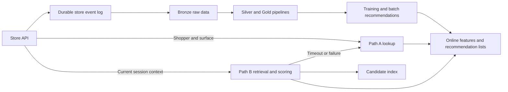
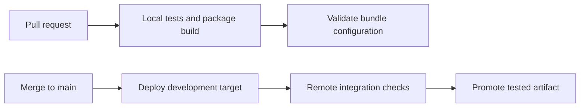

# Developing locally and deploying to Databricks

Use this guide to plan a recommendation platform that can be developed locally and deployed incrementally to Databricks. It adapts the responsibilities in [the architecture reference](databricks-architecture.md) to this learning project.

**Status:** proposed roadmap, not an implemented deployment or a replacement for the agreed [store scaffold plan](implementation-plan.md). Cloud provider, workspace, budget, and runtime choices remain open. Recommendation pipelines, models, and serving remain user-owned.

## Starting point

The repository already provides a working storefront, store API, synthetic history generator, immutable exports, and local Bronze ingestion. See [the current architecture](implementation/architecture.md) and [local development commands](local-development.md).

The recommendation API in [apps/api](../apps/api/main.py) is a placeholder. [packages/recommender](../packages/recommender/pyproject.toml) has no recommendation dependencies yet. Silver/Gold pipelines, model training, vector retrieval, online features, and personalized serving are not implemented. There is no Databricks bundle or CI/CD workflow in the repository today.

The recommended approach is to develop locally while testing small integrations on Databricks early. Local work provides fast feedback on data and recommendation logic. Remote work tests the platform assumptions that a local environment cannot reproduce: access controls, managed storage, synchronization, resource deployment, and service latency.

## Preserve the two data flows

The reference separates historical learning from immediate session context. Keep that boundary throughout development:



**Path A** reads a precomputed list keyed by shopper and surface. For example, a homepage request retrieves product IDs from the latest published batch. The store API hydrates those IDs from its catalog and applies current availability checks.

**Path B** assembles candidates and scores them using context supplied in the request, such as recent product views, searches, and cart contents. It does not wait for the same actions to arrive in Bronze. It can fall back to Path A or the existing fixed trending list.

PostgreSQL remains the store's operational database. Analytical tables and recommendation-owned online storage have separate responsibilities. Introducing an online recommendation database does not require migrating store transactions at the same time.

## Map responsibilities between environments

These mappings describe possible implementations, not equivalent performance or managed-service behavior.

| Responsibility | Local implementation | Databricks target |
| --- | --- | --- |
| Store UI and operational API | Existing React/Fastify apps and PostgreSQL | Can remain outside Databricks |
| Event ingestion | Existing immutable exports | Uploaded exports first; Zerobus later |
| Raw analytical data | Existing local Spark/Delta Bronze | Unity Catalog Delta tables |
| Transformations and batch jobs | Python modules with local Spark | Scheduled Databricks jobs; managed pipelines where useful |
| Experiment tracking and models | Local MLflow, when introduced | Workspace tracking and registered models |
| Online features and lists | Recommendation-owned PostgreSQL in Docker | Lakebase |
| Candidate retrieval | Local vector index with an explicit query contract | AI Search |
| Recommendation serving | User-built Python API | Model Serving, following the reference |

PostgreSQL is a useful local choice for practicing online list publication and lookup. It does not reproduce Lakebase's managed synchronization or operational behavior. Similarly, a local vector index can exercise retrieval logic but cannot validate AI Search's filtering, synchronization, or latency.

## Proposed milestones

### 1. Deliver one local Path A surface

Start with the homepage. Produce a recommendation list through an offline job, publish it to recommendation-owned storage, and expose a lookup through the Python recommendation API. The existing fixed list provides a fallback.

An initial baseline can validate this flow before a learned model is introduced. Define the publication metadata alongside product IDs: shopper, surface, generation time, and the version of the logic or model that produced the list.

This milestone is complete when a published list reaches the storefront, another batch can replace it consistently, and missing lists or API failures produce a usable fallback. Catalog hydration and checkout continue to belong to the store API.

### 2. Deploy the offline slice to Databricks

Upload a small immutable export and validate remote Bronze ingestion before deploying downstream transformations. Keep the storefront local. Package pipeline code so the same transformation logic can be called by local entry points and remote jobs.

Compare local and remote results for the same input. Check logical event counts, raw payload preservation, snapshot identities, and replay behavior. Once downstream jobs exist, compare their output schemas and values too.

This milestone is complete when a deployment from Git can ingest the batch, rerun without duplicating logical records, reject conflicting or skipped data, and recover from a failure between commits.

### 3. Develop Path B and test managed integrations

Define the request contract for shopper, surface, recent session signals, and requested result count. Keep feature assembly, scoring, and business rules in ordinary Python modules, with external feature and candidate lookups behind small interfaces.

Practice the complete flow locally, then connect it to managed services. Measure the full request, including network calls and fallback behavior. Treat the architecture reference's latency figures as targets to investigate, not guarantees for this project.

This milestone is complete when a controlled change in session context affects the result as intended, unavailable products are excluded, and slow or failed dependencies trigger a bounded fallback.

### 4. Replace remaining local components incrementally

Publish recommendation lists and features to Lakebase, switch candidate retrieval to AI Search, and package the serving pipeline for Model Serving. Validate each replacement independently before combining them.

Add streaming ingestion after batch replay and downstream correctness are established. Preserve the store's transactional event writes. A separate forwarder can deliver committed events without making checkout depend on a network call to Databricks.

Zerobus provides several ingestion protocols. Its Kafka-compatible interface implements a producer-side subset rather than a complete Kafka broker. Choose the protocol and recovery behavior deliberately; adding a local Kafka broker is not required for the initial export-based path. See [Zerobus API protocols](https://docs.databricks.com/aws/en/ingestion/zerobus-api-protocols).

## Changes needed for remote Bronze ingestion

The existing [ingester](../tools/bronze/ingest.py) is explicitly local. Port its guarantees while replacing its filesystem assumptions:

| Current mechanism | Remote design requirement |
| --- | --- |
| Local paths and Python file reads | A supported upload location and a way to verify the manifest and bytes remotely |
| `master("local[2]")` and local Delta setup | A Spark session supplied by the selected Databricks runtime |
| Path-based Delta tables | Configured, governed table names and storage locations |
| Unix `fcntl` lock | Serialization that covers every writer, initially through a single controlled job |
| `progress.json`, `fsync`, and atomic rename | Durable per-source progress suitable for the remote storage system |

Keep the source-specific cursor, contiguous-range validation, conflict detection, and logical merge keys. Advance progress only after event and catalog writes succeed. These writes are separate commits; recovery must work if a run stops between them or before saving progress. Moving progress to a table alone does not create a transaction across all outputs.

For the first remote version, one job can own ingestion and disallow overlapping runs. That is only sufficient if other jobs and manual writers cannot bypass the same coordination. Introduce stronger coordination when multiple writers are actually needed.

The [Bronze implementation guide](implementation/bronze.md) describes the existing protocol and tests to preserve.

## Keep code portable where it matters

Separate transformation and prediction logic from environment setup. Pass table names, storage locations, service addresses, and credentials through configuration. Keep Databricks-specific initialization and SDK calls in entry points or adapters rather than scattering them through scoring code.

Package deployable Python code as a wheel and use thin job entry points. A notebook can support exploration without becoming the only place where pipeline behavior is defined. Keep local and remote contracts aligned for schemas, time cutoffs, embedding dimensions, filters, and model input ordering.

Runtime compatibility needs an explicit decision. Bronze uses Python 3.12, Spark 4.0.1, and Delta 4.0.0; the recommendation package currently requires Python 3.14 or later. Select a supported Databricks runtime and compatible deployment dependencies before packaging those projects. Do not assume the local environments can be deployed unchanged or combine their environments implicitly.

Databricks Connect offers another workflow: author and debug from a local IDE while Spark operations execute remotely. It requires remote compute and does not emulate Databricks locally. See [Databricks Connect](https://docs.databricks.com/aws/en/dev-tools/databricks-connect/).

## Infrastructure as code and CI/CD

Use **Declarative Automation Bundles**, formerly Databricks Asset Bundles, to define application resources alongside code: jobs, pipelines, experiments, registered models, and serving endpoints. Bundles can also manage Lakebase resources. See [bundle overview](https://docs.databricks.com/aws/en/dev-tools/bundles/) and [Lakebase bundle support](https://docs.databricks.com/aws/en/oltp/projects/manage-with-bundles).

Use **Terraform** where foundational infrastructure is needed, such as cloud storage, networking, and workspace configuration. Define one owner for each resource so Terraform and bundles do not both manage it. A first deployment into an existing workspace may only need a bundle. See [the Databricks Terraform provider](https://docs.databricks.com/aws/en/dev-tools/terraform/).

The proposed delivery flow is:



Local checks establish transformation and API behavior. Remote checks establish that the deployed package can access the intended tables, run with its assigned identity, publish outputs, and recover from retries. Bundle validation checks configuration; it does not replace those integration checks.

After a bundle and workspace exist, the typical CLI sequence is shown below. This is a deployment pattern, not a runnable repository workflow today. The proposed job key `offline_recommendations` would need to be defined in the bundle:

```sh
databricks bundle validate -t dev
databricks bundle deploy -t dev
databricks bundle run -t dev offline_recommendations
```

Keep the deployable artifact tied to a Git revision. Promote the artifact that passed checks, and define model promotion separately from code deployment. A failed model evaluation should not automatically publish a new model or replace existing recommendation lists.

GitHub Actions can run these steps. For a workspace that supports it, use a service principal with workload identity federation so automation authenticates with short-lived credentials. See [Databricks CI/CD with GitHub Actions](https://docs.databricks.com/aws/en/dev-tools/ci-cd/github).

## Validation boundaries and decisions still needed

Local tests can verify leakage boundaries, deterministic transformations, chronological evaluation, replay correctness, API contracts, publication behavior, and fallback logic. They cannot establish managed-service latency, cloud permissions, autoscaling, synchronization freshness, or real-world recommendation effectiveness.

Catalog exports capture current state at export time. They do not reconstruct historical stock or availability. Generator-only latent preferences remain outside model inputs, and delivery-quality experiments remain separate from authoritative events and ordinary Bronze exports.

Before creating cloud resources, decide:

- Which cloud and workspace are available, and what services that workspace supports.
- The learning budget and when development resources should run or be stopped.
- The supported runtime and dependency versions for remote jobs and serving.
- Whether the immediate goal is portable recommendation logic, Databricks operations practice, or both.

The proposed first deliverable is one working homepage recommendation flow locally, plus a repeatable Databricks deployment of its offline pipeline. It provides a concrete basis for deciding how much of the remaining reference architecture to adopt.
