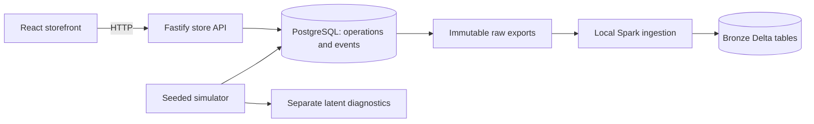

# System boundaries and data flow

Understand which component owns a store action and how it becomes learning data. The project starts with an operational store because useful recommendation experiments need coherent identities, products, exposures, and transactions.

## Operations and observations have different owners

A shopper adds a kettle. The backend changes their cart and appends a cart event in one transaction. If that transaction fails, neither change survives. When the shopper merely sees the kettle card, the browser knows about the visibility and sends an impression separately. A page can lose an observation while a successful order still exists.

This division gives a clear owner for each fact. Browser code owns what it observes; store transactions own what successfully changes. Recording a purchase in both layers would count one order twice. Source fields distinguish live observation, backend action, and synthetic history.

The shared contract ties those producers together. It is the shape of the data, not an implementation of recommendation logic. [The event reference](../reference/events.md) describes that shape.

## Store persistence and analytical persistence serve different work

PostgreSQL answers operational questions: what is in this shopper's bag, is the product available, and did this checkout already finish? These queries need current state and transaction boundaries.

Bronze answers provenance questions: what raw records arrived from a particular source, with what event/receipt times and catalog snapshot? Delta retains those records for later analysis. The export boundary keeps the store runnable without a Spark process on every request.

Raw ingestion does not build features. Cleaning, sessionization, embeddings, candidate retrieval, ranking, and evaluation belong to the user's recommendation workspace. The [scope reference](../reference/project-scope.md) records this ownership.

## Cart and checkout services own use cases

The cart mutation and checkout handlers in [server.ts](../../apps/store-api/src/server.ts) resolve the live session, validate HTTP input, and delegate to [CartService](../../apps/store-api/src/services/cart.ts) or [CheckoutService](../../apps/store-api/src/services/checkout.ts). The services accept ordinary session data and have no Fastify dependency. They decide the business steps and wrap the entire operation in `Store.transaction`.

`CartService.setQuantity` checks product listing/availability and records an event only when the quantity changes. `CheckoutService.execute` checks the retry key before cart validation, calculates totals and purchased item snapshots, persists the order, records purchase, and clears the cart. [Store](../../apps/store-api/src/db.ts) supplies parameterized persistence methods and the existing transaction/event integrity machinery. Business errors carry application codes; the HTTP adapter maps them to 404 or 409 responses.

This is a focused service layer for those two writes. Catalog, identity, order-history reads, and browser event intake still use the existing handlers. There are no new repository interfaces, ORM, or rich domain entities. Services assume callers have resolved the session and validated input; direct calls do not enforce HTTP session expiry or refresh activity. See the [Python comparison](node-backend-for-python-developers.md) for how these boundaries map to familiar Python patterns.

## Future online context is a separate path

Suppose a shopper views three tents within a minute. A future session-aware recommendation request should be able to send those current views directly, even if the latest raw export has not reached Bronze. Long-term features can still come from an offline pipeline. Waiting for the analytical landing step would turn ingestion delay into recommendation context delay.

This is a proposed integration boundary. The current homepage is a fixed seed list and the Python recommendation API is a placeholder. [The roadmap](recommendation-roadmap.md) explains the possible extension without treating it as deployed behavior.

Related: [repository map](../reference/workspace.md), [checkout explanation](transactions.md), [index](../README.md).
