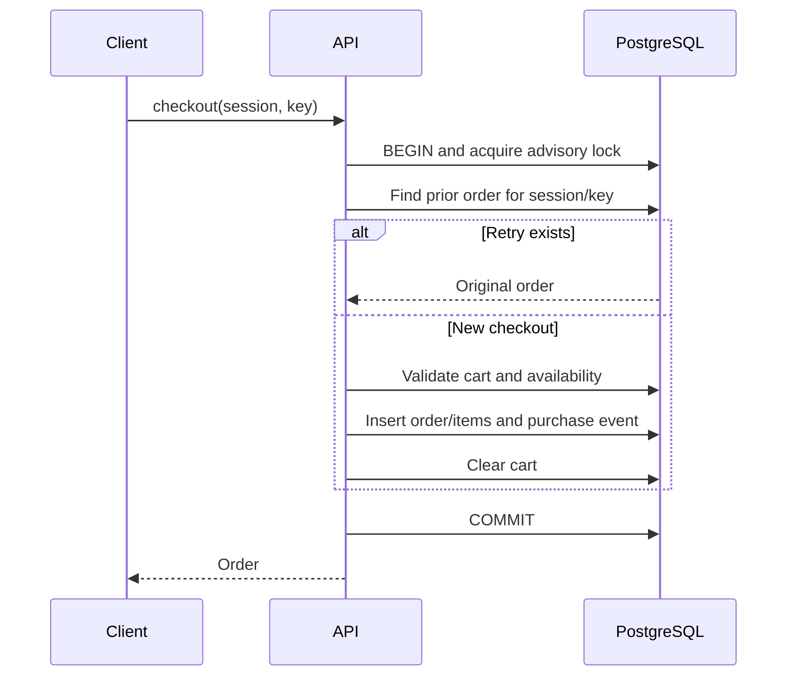

# Atomic checkout, retries, and event sequences

Understand how the store turns a cart into exactly one recorded order despite failures and repeated requests.

## One successful operation has one commit boundary

For two mugs, checkout needs an order total, two-item quantity snapshot, purchase event, and cleared cart. A failure after writing the order but before recording purchase would otherwise leave inconsistent learning data. A database transaction makes those writes succeed or roll back together.

The final store snapshots item names/prices in `order_items`. Later catalog changes do not rewrite what was purchased. It does not emit removals when checkout consumes a cart; the purchase is the causal record of that transition.

## Retry safety needs a stable key and serialization

Imagine the server commits, but its response never reaches the browser. Retrying with a new key could create another purchase if the cart were rebuilt. Retrying the same session/key returns the original order before checking the now-empty cart.

A unique constraint is useful, but concurrent retries also need a defined path before they read and mutate shared state. The store acquires a schema-scoped transactional advisory lock, then looks up the prior order. Participating requests execute in order. [Store.transaction](../../apps/store-api/src/db.ts) keeps the callback on one pooled client through `AsyncLocalStorage`.

This is a small-system tradeoff: understandable correctness costs write concurrency, and generation/export can hold the same lock for a long time. It is not a throughput design for a large store. Direct writers bypassing the convention are outside that protection.

## Committed append order must survive rollback

Bronze requests a contiguous range: after 20 through 25 means events 21, 22, 23, 24, and 25. Ordinary database sequences can consume values even when a transaction rolls back. This store increments a singleton counter in the same transaction as the event. A failed batch returns the counter to its previous value; no committed sequence gap appears.

Sequence is append order, not necessarily occurrence order. A delayed browser event can have an earlier `occurredAt` but a later sequence. Both pieces of information are retained for their different jobs.

Related: [PostgreSQL lesson](../tutorials/04-postgres-transactions.md), [database reference](../reference/database.md), [Bronze recovery](bronze-recovery.md), [index](../README.md).
