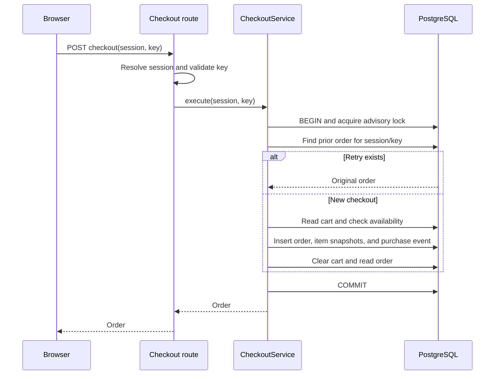

# Atomic checkout, retries, and event sequences

Understand why a checkout either commits all its store changes or none, and why retrying a successful checkout with the same session/key returns the existing order. These are separate guarantees: **atomicity** prevents partial changes; **idempotency** prevents a retry from repeating the business operation.

This page describes the implemented fake checkout. It covers PostgreSQL operations and events; there are no payment or shipping calls.

## Follow the request through its owners

The request is `POST /checkout` with an `x-session-id` header and a JSON body containing `idempotencyKey`.

| Component | Responsibility |
| --- | --- |
| [StoreProvider.checkout](../../apps/web/src/state/StoreProvider.tsx) | Generate a key for an attempt and retain it for retries |
| [Checkout route](../../apps/store-api/src/server.ts) | Resolve a live session, validate the key, and call the service |
| [CheckoutService.execute](../../apps/store-api/src/services/checkout.ts) | Coordinate retry lookup, business checks, order snapshots, purchase event, and cart clearing |
| [Store](../../apps/store-api/src/db.ts) | Execute parameterized queries on one transaction connection |
| [PostgreSQL schema](../../apps/store-api/src/schema.ts) | Enforce keys/constraints and persist committed changes |

The service starts its work with this code:

```ts
return this.store.transaction(async () => {
  const prior = await this.store.orderForCheckout(session.id, idempotencyKey);
  if (prior) return prior;
  // Remaining checkout steps follow inside this callback.
});
```

This excerpt omits the remaining steps for clarity. The retry lookup is inside the transaction and happens before cart validation.

## One successful operation has one commit boundary

For two mugs at 1,200 cents each, a successful checkout creates an order totaling 2,400 cents, an item snapshot with quantity two, a purchase event, and an empty cart. A failure after writing the order but before recording purchase would otherwise leave inconsistent learning data.

The service performs these steps inside one `Store.transaction` callback:

1. Look up an order for the session/key; return it if already present.
2. Read the shopper's cart and reject empty carts or unavailable products.
3. Calculate the total and capture purchased names, quantities, and unit prices.
4. Insert the order and its `order_items` through `Store.createOrder`.
5. Record a backend purchase event with the order ID and order creation time.
6. Clear the shopper's cart and read back the order response.

`Store.transaction` checks out one pooled client, runs `BEGIN`, acquires the advisory lock, executes the callback, and runs `COMMIT` before returning its result. On an exception it attempts `ROLLBACK`, then releases the client in `finally`. SQL statements execute during the callback, but their changes remain uncommitted until the final commit.



`AsyncLocalStorage` carries the active client through nested store calls. The order insert, item inserts, event counter update, event insert, and cart deletion therefore use the same transaction. The service does not need an ORM or dirty-object tracking to obtain atomicity. In Python terms, the callback fills the role of the body of an `async with` transaction scope.

If writing the purchase event fails after the order/items were inserted, rollback removes those inserts, restores the event counter, and leaves the cart intact. If a later step fails after the cart was cleared, the cart deletion also rolls back. Successful checkout emits no cart-removal events: purchase is the causal record of that transition.

The transaction boundary covers checkout data, not every effect of the HTTP request. Session resolution updates `lastActiveAt` before checkout begins, so that activity update can survive a failed checkout. A browser response is also outside the database transaction; the database can commit successfully even if the client never receives the response.

Nested `Store.transaction` calls join an existing transaction without savepoints. The route invokes checkout directly, so the service's wrapper owns the commit shown above. If another caller invokes the service inside an outer store transaction, the outer wrapper owns the final commit instead.

## Retry safety needs a stable key and serialization

Imagine PostgreSQL commits order `O1`, but the connection to the browser drops before the response arrives. The browser cannot know whether checkout completed. Retrying the same session/key finds `O1` and returns it without creating another order, appending another purchase, or clearing the cart again.

The persisted retry identity is `(sessionId, idempotencyKey)`. `orders` stores the key alongside the order and enforces this SQL constraint:

```sql
UNIQUE("sessionId", "idempotencyKey")
```

This protects against duplicate rows for the same identity. The key is not globally unique, and it is not scoped to the shopper alone. A different session can use the same string for a different checkout.

Lookup must precede empty-cart and availability checks. A successful checkout has already cleared the cart; checking emptiness first would reject a legitimate retry. Retries return purchased item snapshots, so later catalog name/price/availability changes do not change the stored order. The app treats orders as historical records, although SQL does not block all direct order edits.

### Concurrent retries take turns

A unique constraint alone would prevent duplicate orders, but would not automatically make a losing request return the successful order. Two requests could otherwise both observe that no prior order exists and then compete to insert one.

Our transaction helper acquires this lock before retry lookup:

```sql
SELECT pg_advisory_xact_lock(731024, hashtext(current_schema()))
```

For two cooperating requests with the same session/key:

1. Request A acquires the lock. Request B waits.
2. A finds no order, performs checkout, and commits. Its transaction lock is released.
3. B acquires the lock. Under the default READ COMMITTED isolation, its subsequent lookup sees A's committed order.
4. B returns that order and commits its transaction without repeating checkout writes.

If A rolls back, B finds no prior order and can attempt checkout itself. If B uses a different key after A cleared the cart, it is a new attempt and will fail the empty-cart check unless the cart has been rebuilt.

The lock is scoped to the store schema, not to an individual checkout key. Participating cart mutations, generation, and exports take the same lock, including across cooperating processes. This makes local correctness understandable but limits write concurrency; generation/export can hold the lock for a long time. Direct writers bypassing the convention are outside that protection. It is not a throughput design for a large store.

### The browser must reuse the key

The frontend keeps the key in a React ref:

```ts
checkoutKey.current ??= crypto.randomUUID();
```

It sends that value on each retry and retains it after a failed request. It clears the key after a successful checkout response, after a successful cart mutation, or when adopting a new session. The key is not persisted in localStorage. Reloading starts a new session and loses this in-memory retry identity.

The backend persists successful orders, not failed responses. An attempt that rolls back has no order for its key; a subsequent attempt may succeed once the underlying problem is resolved. A retry still needs a valid live session: the HTTP layer can reject an expired session before reaching the lookup.

Reusing an already successful key always returns the original order, even if the shopper has since added new cart items. The request contains no cart fingerprint, so the backend does not compare a retry against a new cart. A genuinely new checkout needs a new key.

## Separate database outcome from response delivery

| Situation | Checkout state | Retry with the same valid session/key |
| --- | --- | --- |
| Empty/unavailable cart rejected | No checkout writes committed | Runs checks again; there is no cached failure |
| Database operation fails before commit and rolls back | Order, items, purchase, counter changes, and cart changes roll back | Can attempt checkout again |
| Commit succeeds but response is lost | Order/purchase exist; cart was cleared | Returns the existing order |
| Concurrent successful retries | One order and one purchase for that session/key | All successful responses identify the same order |

A timeout or connection failure does not by itself prove rollback: it may occur around commit or after commit. The retry lookup resolves a previously committed checkout when the same session/key remains usable. Atomicity ensures the checkout changes commit together; idempotency handles repeating the request. Neither guarantees that the client receives a response exactly once.

## Committed append order must survive rollback

Bronze requests a contiguous range: after 20 through 25 means events 21, 22, 23, 24, and 25. Ordinary database sequences can consume values even when a transaction rolls back. This store increments a singleton counter in the same transaction as the event. A failed checkout or event batch returns the counter to its previous value; no committed sequence gap appears.

Sequence is append order, not necessarily occurrence order. A delayed browser event can have an earlier `occurredAt` but a later sequence. Both pieces of information are retained for their different jobs.

## Evidence in the tests

| Test source | What it checks |
| --- | --- |
| [Direct service tests](../../apps/store-api/test/services.test.ts) | A trigger rejects purchase recording after order/item writes. The failed checkout leaves zero orders/items, preserves the cart and prior event count/counter, then permits a retry after the failure is removed. Five concurrent calls return the same order with one purchase. Catalog edits leave retry snapshots unchanged. |
| [API tests](../../apps/store-api/test/store.test.ts) | Same-key retries return the same response; unavailable-cart checkout preserves the cart; concurrent HTTP retries create one order and one purchase; application errors retain their HTTP responses. |
| [Browser checks](../../tools/validate/browser.ts) | A failed checkout request followed by retry reuses the same frontend key. |

These are selected regression checks, not exhaustive process-crash or network-failure simulations. The purchase trigger test exercises real PostgreSQL rollback after partial writes, rather than only rejecting checkout before any write.

For the focused transaction checks, run from the repository root with PostgreSQL available:

```sh
node --import tsx --test apps/store-api/test/services.test.ts apps/store-api/test/store.test.ts
```

The fixtures create private schemas and drop them after testing. See [validation](../how-to/validate.md) for prerequisites and the broader API/history/browser checks.

Related: [HTTP contract](../reference/http-api.md), [database reference and diagram](../reference/database.md), [Python backend comparison](node-backend-for-python-developers.md), [PostgreSQL lesson](../tutorials/04-postgres-transactions.md), [Bronze recovery](bronze-recovery.md), [index](../README.md).
