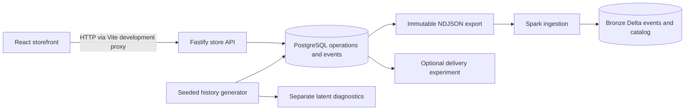

# Architecture and data flow

Understand how a storefront action becomes operational state and then raw analytical data.

PostgreSQL owns current carts, catalog, identities, sessions, immutable order records, and the event log. A successful cart mutation or checkout writes its operational changes and event in one PostgreSQL transaction. Browser observations arrive separately and can fail independently of a successful purchase.

The exporter takes a consistent PostgreSQL transaction and publishes files with provenance and checksums. Bronze preserves those raw envelopes in Delta and advances a durable cursor after both table writes. Delta is the analytical landing layer; it does not serve the storefront.

## One action through the system

Opening a visible catalog card records an impression, then a click referring to that impression, then a product view. Adding the product calls the store API; the API updates the cart and records `cart_add`. Checkout creates order rows, records one purchase, and clears the cart atomically. A later export includes these append-only events, and a manually invoked ingestion lands them in Bronze.

## Ownership and limits

The homepage list is a fixed seeded selection. Search is SQL text matching. There is no retrieval model, ranking service, feature store, or adaptive recommendation logic. The Python recommendation projects are placeholders owned by the user. Silver/Gold, training, evaluation, embeddings, and serving are outside the implemented scaffold.

Future online recommendation calls should carry current session context directly; offline event ingestion is a separate flow. This is an agreed boundary, not a working integration. PostgreSQL and managed/cloud infrastructure are future work.

Continue with [data model](data-model.md), [events](events.md), and [Bronze](bronze.md). The [implementation plan](../implementation-plan.md) records the agreed scope.
