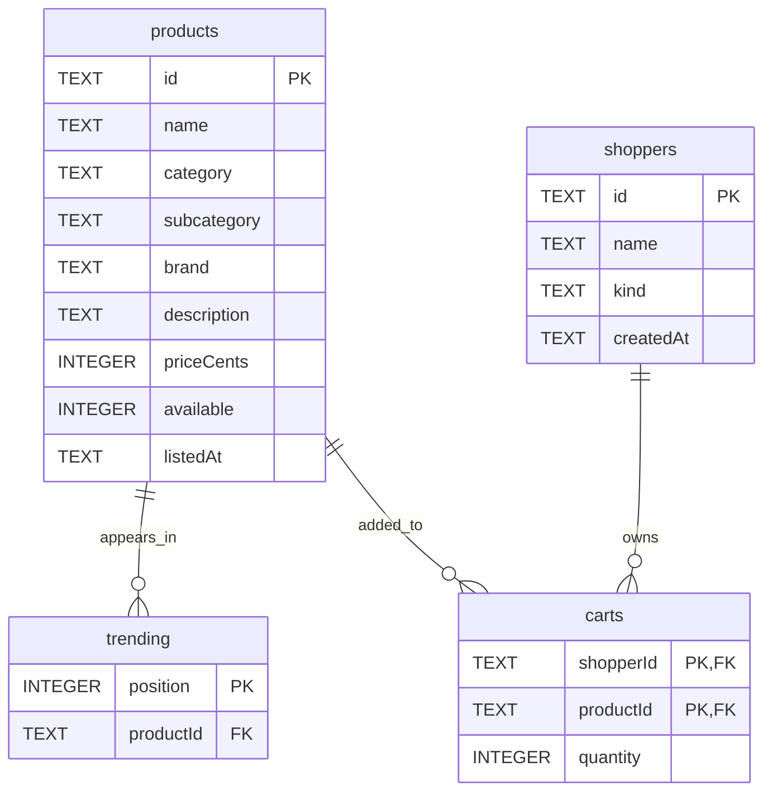
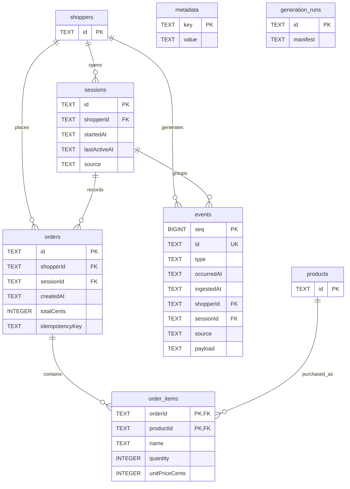

# Operational data model

Use this reference to locate the state behind a store feature. The authoritative schema is in [schema.ts](../../apps/store-api/src/schema.ts), and persistence helpers are in [db.ts](../../apps/store-api/src/db.ts); shared response types are in [contracts](../../packages/store-contracts/src/index.ts).

| Table | Key / relationship | Purpose |
| --- | --- | --- |
| `products` | `id` | Name, category/subcategory, brand, description, cents, availability, listing time |
| `trending` | `position`; product foreign key | Fixed ordered homepage selection |
| `shoppers` | `id` | Anonymous, persona, or synthetic identity |
| `sessions` | `id`; shopper foreign key | Start/activity timestamps and live/synthetic source |
| `carts` | `(shopperId, productId)` | Persistent quantity 1–99 per shopper/product |
| `orders` | `id`; shopper/session foreign keys | Time, total, checkout key; unique `(sessionId, idempotencyKey)` |
| `order_items` | `(orderId, productId)` | Purchased name, quantity, unit price snapshot |
| `events` | Transactional `seq`; unique `id` | Indexed metadata plus full JSON payload |
| `event_counter` | Singleton `id=1` | Last committed event sequence; rolls back with events |
| `metadata` | `key` | Persistent source database UUID |
| `generation_runs` | `id` | Completed configuration and generation counts |

PostgreSQL enforces foreign keys. `Store.transaction()` checks out one pool connection, begins a transaction, obtains a transaction-scoped advisory lock for the schema, and commits or rolls back all statements on that connection. Queries use async/await. The lock serializes event-producing mutations, generation, and export snapshots across processes; a long seed/export can delay live writes.

`event_counter` allocates sequence numbers inside the same transaction as each event. Rollback restores the counter, so the next successful append leaves no sequence hole. A normal PostgreSQL sequence would retain holes after a rollback, which would violate Bronze's contiguous-cursor protocol. This intentionally favors simple local correctness over concurrent write throughput. See [node-postgres transactions](https://node-postgres.com/features/transactions) for connection ownership.

## Catalog and persistent carts

These entity–relationship diagrams show the PostgreSQL schema. `PK` marks a primary key, `FK` a declared foreign key, and `UK` an individual unique column. Multiple `PK` fields form one composite primary key. `||` means exactly one parent; `o{` means zero or more child rows. Types are PostgreSQL column types; product availability is stored as an integer and hydrated as a boolean.

A cart row belongs to a shopper and product, not a session. Its composite key allows one current quantity per shopper/product pair. Trending positions are unique; the schema does not require each trending product to be unique.

## Sessions, orders, events, and bookkeeping

`shoppers` and `products` are repeated here to connect the diagrams; they are the same tables. This diagram includes the domain tables and declared foreign-key relationships. The independent `event_counter` table holds a single integer key and a BIGINT value.

The composite uniqueness constraint on orders is `UNIQUE(sessionId, idempotencyKey)`; neither field is individually unique. `order_items.productId` is both part of its composite primary key and a foreign key to the catalog. Order items retain purchased names and prices as snapshots.

Event context references such as `productId`, `impressionId`, and `orderId` live inside the JSON `payload`; they are not SQL foreign-key columns. `Store.append()` validates these references where required, including click-to-impression and purchase-to-order agreement. SQL foreign keys separately ensure the shopper and session exist; event insertion also checks that the session belongs to that shopper. The schema alone does not enforce shopper/session agreement on an order.

The order-to-items relationship allows zero items at the schema level. Successful checkout and generation create nonempty orders through application logic. `metadata` and `generation_runs` have no foreign keys; their values/manifests hold source identity and run bookkeeping.

## Money, state, and history

Prices and totals use integer cents; the frontend formats USD. Availability is a boolean, not an inventory ledger. Carts hydrate current product data. Orders retain purchased names and prices in `order_items`, so history does not recalculate from current catalog prices.

Events retain occurrence time, ingestion time, identity, source, and JSON context. Database triggers reject event updates, deletes, and truncation. `seq` provides source-local export order; it is not event time and is not a global ordering across databases.

The source UUID is created once in `metadata`. A newly created database gets a distinct identity; copying a database also copies that identity. Generation run metadata contains configuration and counts, not latent shopper preferences. Those preferences live in separate diagnostics files.

There is no ORM, schema migration runner, stock reservation, or analytical transformation here. For behavior built on this model, see [identity](identity.md) and [cart/checkout](transactions.md).
