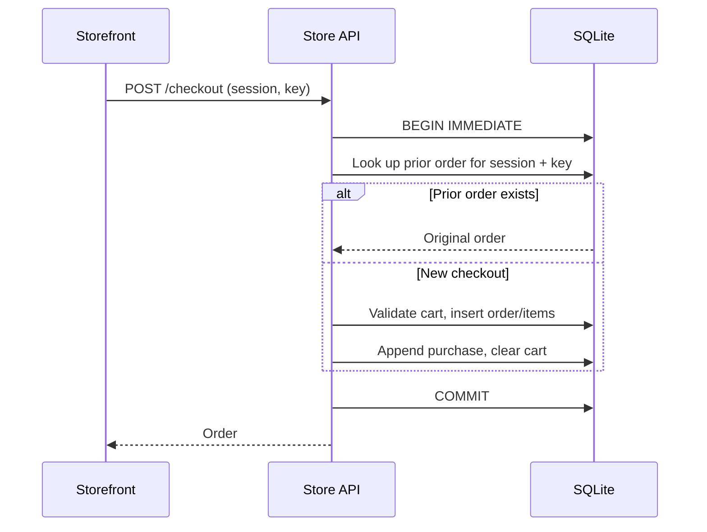

# Persistent carts, checkout, and order history

Understand the atomic boundaries that keep store records and learning events consistent. Routes are in [server.ts](../../apps/store-api/src/server.ts); transaction and hydration helpers are in [db.ts](../../apps/store-api/src/db.ts).

## Cart mutation

`PUT /cart/:productId` takes the resulting quantity, from 0 to 99. Zero removes the item. The API checks listing time and rejects positive quantities for unavailable products. Inside one transaction it compares the prior quantity, changes the cart, and appends the matching backend event:

| Before → after | Event |
| --- | --- |
| 0 → positive | `cart_add` |
| positive → different positive | `cart_update` |
| positive → 0 | `cart_remove` |
| unchanged | No new event |

The event quantity is the resulting total, not a delta. A request setting quantity to 2 means “there are now two,” not “add two.” The response is the hydrated cart. Carts are keyed by shopper, so new sessions retain them.

## Checkout sequence

The backend rejects an empty cart or unavailable cart items with 409. It snapshots item names/prices, calculates the total, appends a purchase at the order's exact timestamp, and clears the cart. Exceptions roll back all those writes. Checkout does not emit separate removal events for the cart it consumes.

Idempotency means a repeated request has the same effect as the first request. The unique `(sessionId, idempotencyKey)` pair returns the original order, even after that checkout cleared the cart. The same key in another session is a different operation. The UI keeps its key across a failed request; it clears the key after success, a successful cart mutation, or identity switching. A reload starts a new session, so this is not a cross-session retry guarantee.

## History and operational reset

`GET /orders` returns the current shopper's orders newest first with saved item values. Fake checkout has no payment, shipping, tax, or stock-decrement integration.

[reset-carts.ts](../../tools/generate/reset-carts.ts) clears only non-synthetic carts. It creates a live session per affected shopper and records a `cart_remove` for each item before clearing it, all in one transaction. Orders, identities, synthetic carts, and prior events remain. Use the [runbook](../local-development.md#validation-and-selective-resets) for the command.

Related: [event contract](events.md) and [validation coverage](validation.md).
