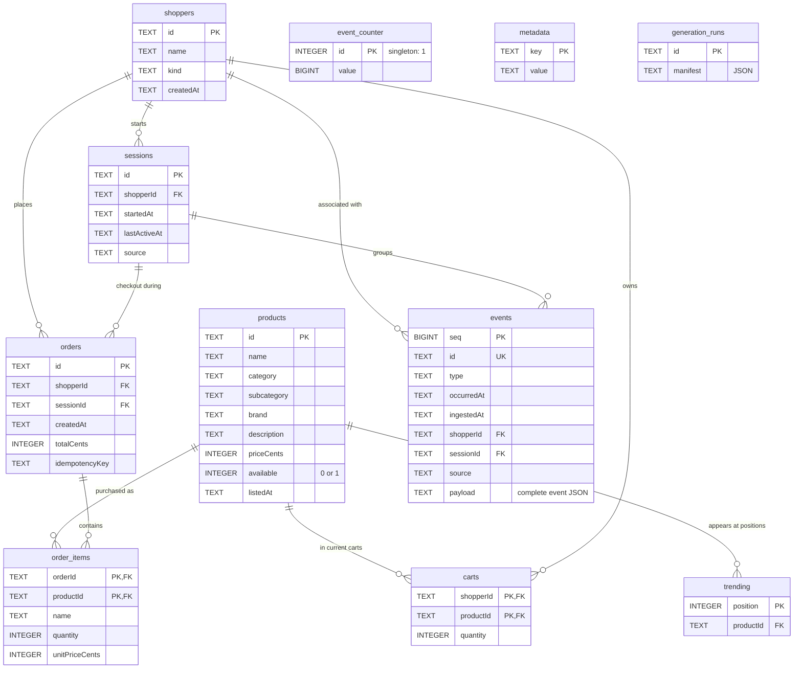

# Operational database reference

Schema: [schema.ts](../../apps/store-api/src/schema.ts). Connection/transaction helpers: [db.ts](../../apps/store-api/src/db.ts). The API stores operations and append-only events in one PostgreSQL database, normally its `public` schema.

Use this page to identify where store data lives, how tables relate, and which rules the database enforces. This is the implemented store schema, not the separate tutorial lab or a proposed recommendation feature store.

## Database design diagram

The entity relationship diagram below shows all eleven tables. `PK` means primary key (a row's unique identity), `FK` means foreign key (a reference enforced by PostgreSQL), and `UK` means unique key. A line from `||` to `o{` means one parent can have zero or more child rows; each child references exactly one parent. Fields marked `PK` together form a composite primary key.

All diagram edges represent declared SQL foreign keys. The three standalone tables have no foreign keys: `event_counter` allocates event sequences through application SQL, `metadata` stores the persistent export source identity, and `generation_runs` records completed synthetic runs. The composite unique constraint on `orders(sessionId, idempotencyKey)` is listed below; neither field is individually unique. SQL permits the same product at multiple `trending` positions.

### Reading the design

- **Catalog:** `products` holds current product data. `trending` maps fixed homepage positions to products; it contains no model scores or attribution.
- **Identity and current state:** a shopper can have many sessions. Cart rows belong to the shopper, so starting a new session does not discard that shopper's cart. There is no separate cart header table: each row is one product and quantity for a shopper.
- **Purchase history:** an order identifies both the shopper and the checkout session. Its `order_items` retain purchased names and unit prices, so later catalog edits do not rewrite those values. The diagram allows zero items because foreign keys alone do not require an order to have children; the checkout operation creates items for a nonempty cart.
- **Behavioral history:** `events` holds both browser observations and confirmed backend transactions, as well as synthetic history. Its indexed columns support lookup and export, while `payload` retains the complete versioned event JSON, including context and `schemaVersion`.

For example, a shopper's session can generate an impression and click, then update a cart row. Checkout creates an order and its items, appends a purchase event, and clears the shopper's cart in one transaction. The order and events remain after the cart is cleared.

### References inside event JSON

`payload.context.productId`, `orderId`, and `impressionId` are application-validated references inside JSON text, not SQL foreign-key columns. They are deliberately omitted from the foreign-key diagram:

| Context field | Reference checked by `Store.append` |
| --- | --- |
| `productId` | Product exists and was listed at the event time |
| `orderId` for a purchase | Order exists and matches the event session and occurrence time |
| `impressionId` for a click | Prior impression matches session, product, surface, and position |

`Store.append` also checks that the event's shopper matches its session. The independent shopper and session foreign keys do not enforce that pairing on their own. See the [event contract](events.md) for required context fields and attribution rules.

## Tables

| Table             | Keys and constraints                                               | Stored fields/purpose                                             |
| ----------------- | ------------------------------------------------------------------ | ----------------------------------------------------------------- |
| `products`        | `id` PK; positive `priceCents`; availability integer 0/1           | Name, category/subcategory, brand, description, listing timestamp |
| `trending`        | `position` PK; product FK                                          | Fixed homepage product IDs                                        |
| `shoppers`        | `id` PK                                                            | Name, kind, creation timestamp                                    |
| `sessions`        | `id` PK; shopper FK                                                | Start/activity timestamps, live/synthetic source                  |
| `carts`           | `(shopperId, productId)` PK; both FKs; quantity 1–99               | Current cart per shopper                                          |
| `orders`          | `id` PK; shopper/session FKs; unique `(sessionId, idempotencyKey)` | Creation time, total cents, checkout retry key                    |
| `order_items`     | `(orderId, productId)` PK; both FKs; quantity >0                   | Purchased name and price snapshots                                |
| `event_counter`   | Singleton PK `id=1`; nonnegative BIGINT value                      | Last committed event sequence                                     |
| `events`          | Positive BIGINT `seq` PK; unique `id`; shopper/session FKs         | Type, occurrence/ingestion times, source, JSON payload as TEXT    |
| `metadata`        | `key` PK                                                           | Persistent source UUID at `sourceId`                              |
| `generation_runs` | `id` PK                                                            | JSON manifest as TEXT for completed generation configs            |

Camel-case SQL columns are quoted, such as `"shopperId"`. Timestamps are TEXT in the event contract's UTC ISO representation. Product availability is converted to a boolean in API/export payloads. Types/kinds are represented in application contracts; SQL does not enforce every enum or cross-entity relationship. In particular, application validation enforces that an event shopper matches its session.

Indexes exist on event session ID and order shopper ID. An append-only statement trigger rejects UPDATE, DELETE, and TRUNCATE on `events`; even an update/delete affecting no rows is rejected. Orders are treated as historical records by the app, but do not have equivalent mutation-blocking triggers.

## Store methods

| Method                                          | Behavior                                                                                 |
| ----------------------------------------------- | ---------------------------------------------------------------------------------------- |
| `Store.open(url?, namespace='public')`          | Opens pool, initializes schema and source ID; URL defaults to environment then local URL |
| `transaction(async callback)`                   | BEGIN, schema-scoped advisory lock, callback, COMMIT; ROLLBACK on error                  |
| `product(id)`                                   | Product or undefined; helper itself does not filter future listings                      |
| `cart(shopperId)`                               | Joins cart to current product data                                                       |
| `order(id)`                                     | Order with historical item name/price snapshots; caller must supply existing ID          |
| `append(event)`                                 | Validates identity/references/replay, increments transactional sequence, inserts payload |
| `event(session, type, context, time?, source?)` | Creates UUID event; defaults to backend source and current time                          |
| `seedPersonas()`                                | Inserts the three stable demo personas if absent                                         |
| `db.prepare(sql).get/all/run(...params)`        | Async query facade using PostgreSQL `$1` parameters                                      |
| `db.exec(sql)`, `db.close()`                    | Executes SQL; closes pool                                                                |

An `AsyncLocalStorage` context directs all operations inside a transaction to the same checked-out client. Nested transaction callbacks join the outer transaction; they do not establish savepoints. Advisory locking serializes participating store transactions across processes for the same schema. Direct SQL and some simple API writes do not acquire this lock; it is not a database-wide prohibition on other writers. Isolation is PostgreSQL's default READ COMMITTED; coherent store exports rely on cooperating mutations taking the same lock.

The BIGINT parser rejects values outside JavaScript's safe integer range. The counter increments transactionally, so failed appends/batches do not consume sequence numbers. There is no versioned migration system or SQLite import command. Schema setup runs on open; editing `CREATE TABLE IF NOT EXISTS` does not alter an existing table.

## Identity fixtures

| ID               | Label                  |
| ---------------- | ---------------------- |
| `persona-home`   | Alex · home projects   |
| `persona-active` | Sam · active days      |
| `persona-family` | Jo · family essentials |

Test fixtures create a UUID-named `test_...` schema and drop it at cleanup. They leave `public` learning data untouched.

Related: [transactions](../explanation/transactions.md), [manage experiments](../how-to/manage-experiments.md), [index](../README.md).
